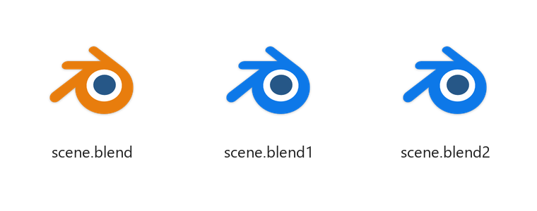

<div align="center">


# blend1-blue

**Give Blender's `.blend1` backup files a blue icon, so you stop opening the backup by accident.**

A Blender extension for Windows · no admin rights · disable it and everything is back

[](https://github.com/bayromest/blend1-blue/stargazers)
[](https://github.com/bayromest/blend1-blue/releases/latest)
[](https://bayromest.github.io/blend1-blue/)
[](https://github.com/bayromest)

<picture>
  <source media="(prefers-color-scheme: dark)" srcset="assets/preview-dark.png">
  
</picture>

</div>

---

## The problem

Every time you save, Blender keeps the previous version as `yourfile.blend1`. On Windows
that backup gets **the exact same orange icon** as the real file, sitting right next to it.

So you double-click the wrong one, work for an hour, and realise you were in last save's
version. We've all done it.

## The fix

`blend1-blue` gives every backup (`.blend1` up to `.blend32`) its own icon: the same Blender
icon your `.blend` files show, with the orange swapped for **Blender's own logo blue**.

It matches your setup automatically: the bare logo if Blender came from Steam, a portable
zip or an "Open with" choice, or the paper-sheet file icon if you used the official installer.

- Orange `.blend` → your file.
- Blue `.blend1` → the backup. Leave it alone unless something went wrong.

Double-clicking a backup still opens it in Blender, so recovering from a crash works
exactly like before. It just won't happen by accident anymore.

## Install

### From Blender, with automatic updates (recommended)

1. In Blender, open *Edit → Preferences → Get Extensions*.
2. Open *Repositories* (top right), click **+**, then *Add Remote Repository*.
3. Paste this URL and click *Create*:

   ```text
   https://bayromest.github.io/blend1-blue/index.json
   ```

4. Search for **Blend1 Blue** and click *Install*. The blue icons apply right away.

Blender now checks this repository for updates like any other extension.

### Drag and drop

Open the [Blend1 Blue page](https://bayromest.github.io/blend1-blue/) and drag the
**blend1_blue** link into a Blender window. Blender installs it and offers to add the
repository, so you still get updates.

### Offline

Download **`blend1_blue-1.0.0.zip`** from the [latest release](../../releases/latest) and drag
it into Blender (or *Get Extensions → ⌄ → Install from Disk*). You won't get updates this way.

**To undo:** disable or uninstall the extension. Closing Blender does *not* remove the icons,
they stay until you turn the extension off.

## What it actually does

Nothing magic, and nothing outside your own Windows user account:

| What | Where |
| --- | --- |
| Registers a "Blender Backup File" type with the blue icon | `HKCU\Software\Classes\Blender.BackupFile` |
| Points `.blend1` … `.blend32` at it | `HKCU\Software\Classes\.blendN` |
| Reuses the command Windows opens `.blend` files with | so double-click still opens the same Blender |
| Clears any saved *"Always open with"* choice for backups | it would otherwise override the icon |
| Remembers anything it replaced | `HKCU\Software\blend1-blue`, used when undoing |

The icon file itself lives in the extension's user folder. No admin rights, no background
process, and Blender itself is never modified.

> [!TIP]
> Installed a **new Blender version** and want backups to open in it? Click
> *Refresh Icons* in the extension's preferences.

## The color

The Blender logo has two colors besides white: the orange `#E87D0D` and the blue of
its eye, `#265787`. Backups simply use the logo's own blue everywhere, so they still look
unmistakably like Blender, just "the quiet one".

| | Hex | |
| --- | --- | --- |
| Blender orange | `#E87D0D` |  |
| Blender blue | `#265787` |  |

Both icons are generated from Blender's own icons by [`tools/recolor.py`](tools/recolor.py),
which replaces only the orange pixels, including their anti-aliased edges, so outlines stay
perfectly smooth. The white ring and the eye are untouched. Every size from 16 to 256 px is included.

To rebuild them yourself from your Blender install (needs Python with `pillow` and `pefile`):

```bash
python tools/extract_icon.py "C:\path\to\Blender\blender.exe" 0 blender-logo.ico
python tools/recolor.py blender-logo.ico icons/blend1-blue.ico
python tools/extract_icon.py "C:\path\to\Blender\blender-launcher.exe" 1 blender-file.ico
python tools/recolor.py blender-file.ico icons/blend1-blue-file.ico
```

To build the extension and regenerate the update repository in [`docs/`](docs) (served by
GitHub Pages), using Blender's own validator and builder:

```bash
python tools/build_extension.py "C:\path\to\Blender\blender.exe"
```

To publish a new version: bump `version` in
[`blender_manifest.toml`](extension/blend1_blue/blender_manifest.toml), run the command above,
then commit and push. Everyone who added the repository gets the update in Blender.

## FAQ

**Does it change anything in Blender?**
No. File icons belong to Windows, so this only touches Windows' file-type settings for
your user account. Blender itself is never modified.

**Microsoft Store version of Blender?**
Not supported. Store apps run in a sandbox that keeps their registry changes private, so
the extension can't change Explorer's icons from there.

**I removed Blender before disabling the extension. How do I undo it?**
Paste this into a terminal (it only touches your own user account):

```bat
for /L %i in (1,1,32) do reg delete "HKCU\Software\Classes\.blend%i" /f
reg delete "HKCU\Software\Classes\Blender.BackupFile" /f
reg delete "HKCU\Software\blend1-blue" /f
```

**macOS / Linux?**
Not yet. On Linux this is doable with a shared-mime-info entry; contributions are very
welcome.

**My backups are still orange.**
Click *Refresh Icons* in the extension's preferences and press <kbd>F5</kbd> in Explorer.
If a cached icon still sticks, sign out and back in.

**Can I turn off `.blend1` files completely?**
Yes, in Blender: *Edit → Preferences → Save & Load → Save Versions = 0*. But backups have
saved a lot of people's work. This project is for keeping them *and* not tripping over them.

## Contributing

Issues and pull requests are welcome, especially a macOS or Linux version, or a better
icon idea.

## License

The code is [GPL-3.0-or-later](LICENSE), like Blender itself.

The icons are derived from Blender's own icons and are not covered by that license. Blender
and the Blender logo are trademarks of the [Blender Foundation](https://www.blender.org/about/logo/).
This is an independent community project, not affiliated with or endorsed by the Blender
Foundation. That's also why it isn't on extensions.blender.org, which doesn't allow the Blender
logo in extensions; it's distributed from its own repository instead.
